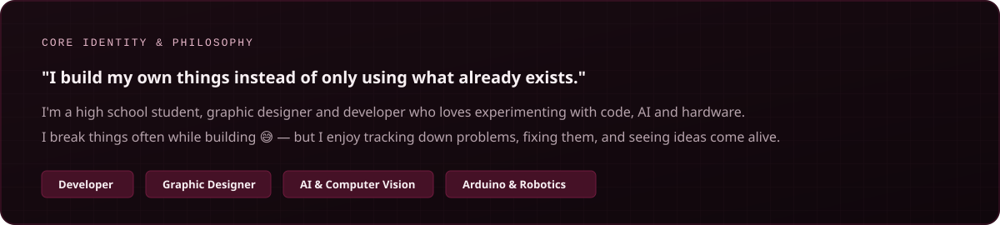
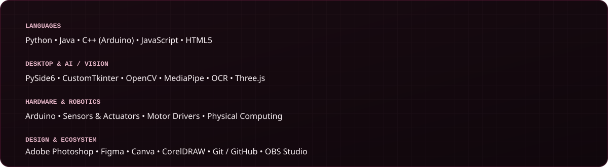

  <!-- 🍷 Hero Banner with Your Photo Inside the Circle & Gliding Cursor -->
  

    

  <!-- ✨ Dynamic Typing Animation with Blinking Cursor -->
  

    

  <!-- Connect Badges -->
  

    
    
    
  

 

<!-- 01 About -->

  

<!-- 02 Selected Works with Live Repo Cards -->

  
  
  
    

  
  

 

<!-- 03 Toolkit -->

  

<!-- 04 Commit Log -->

  
  
  
    
  
  

  

<!-- Footer Signature -->

