  

    

  <!-- Connect Badges -->
  

    
    
    
  

 

<!-- 01 About -->

  

<!-- 02 Selected Works -->

  

  

 

<!-- 03 Toolkit -->

  

<!-- 04 Commit Log -->

  
  
  
    
  
  

  

<!-- Footer Signature -->

